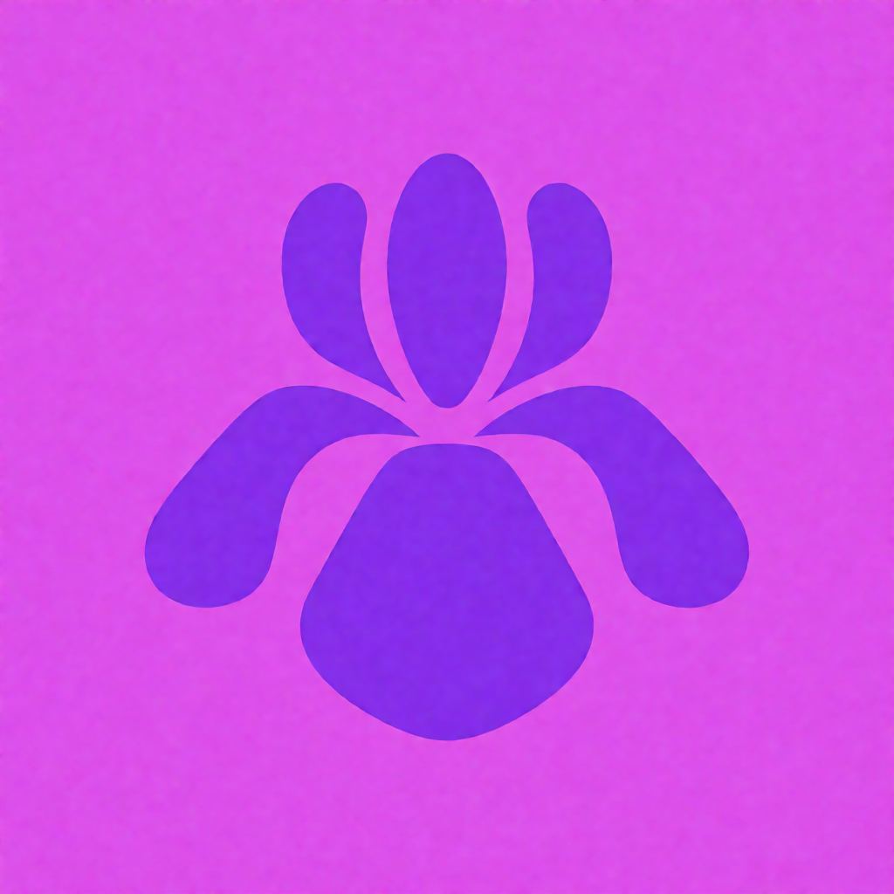
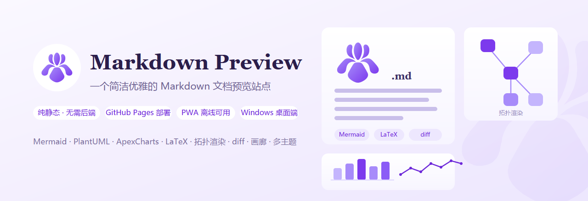
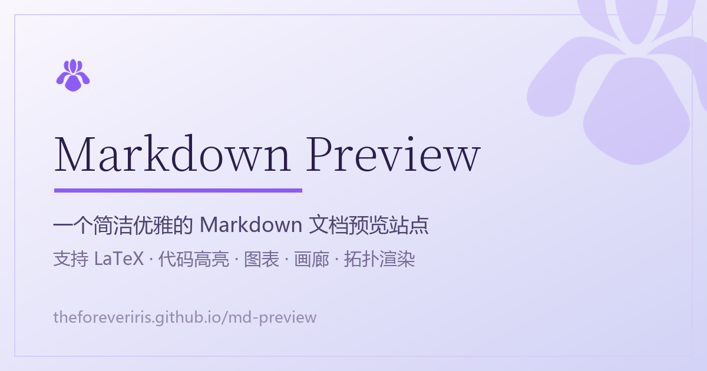
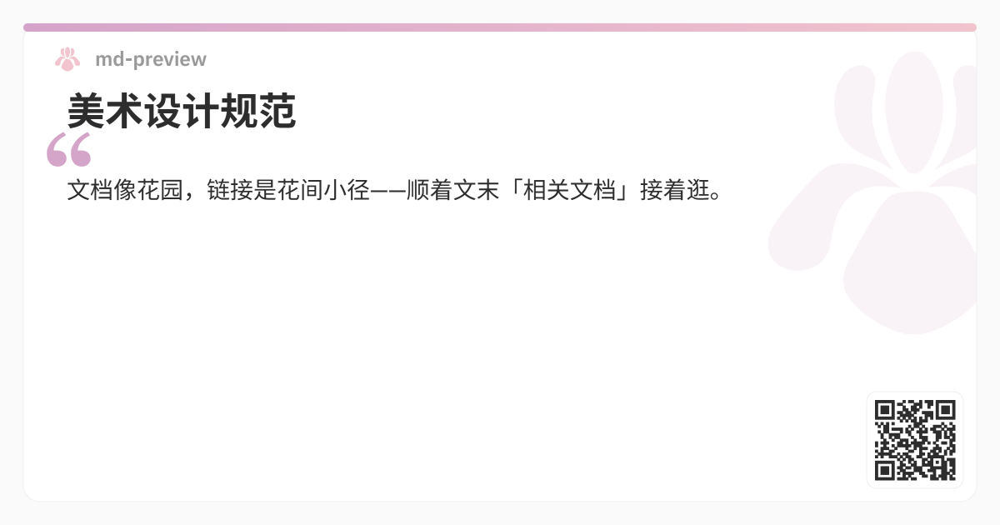
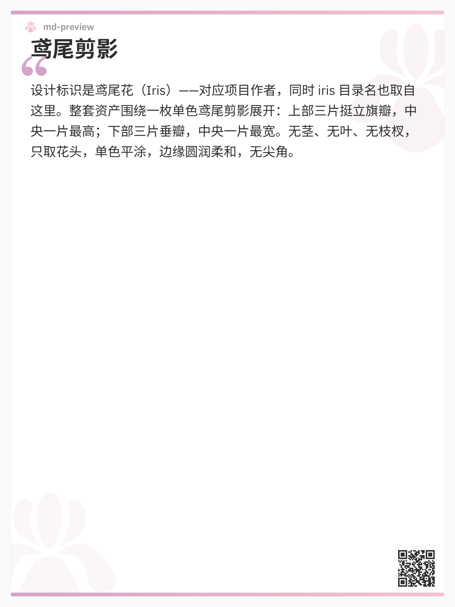
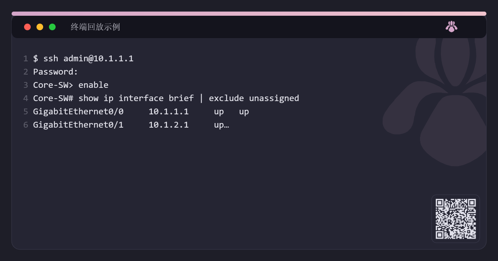
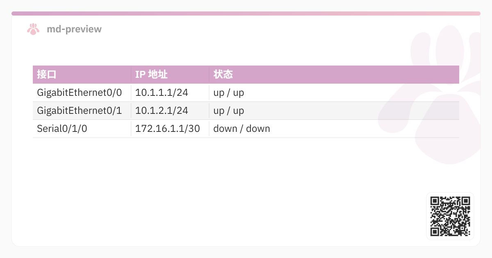

# 美术设计规范 — Markdown Preview

本文件是本项目所有图像资产（应用图标、PWA 图标、桌面端 exe 图标、分享卡片、README 横幅）的设计规范与生成流程。

设计标识是**鸢尾花（Iris）**——对应项目作者 `theforeveriris`，同时 `iris/` 目录名也取自这里。整套资产围绕一枚单色鸢尾剪影展开。

> 本文件面向开发者与后续维护者。终端用户可参考 [docs/theme-customization.md](docs/theme-customization.md) 调整站点主题色。

---

## 一、设计令牌

### 1.1 主色板

| 令牌 | 色值 | 用途 |
|------|------|------|
| `iris` | `#8B5CF6` | **品牌主色**。图标主体填充色、强调色、描边色 |
| `iris-deep` | `#6D28D9` | 深色变体。文字强调、图标渐变末端 |
| `iris-light` | `#A78BFA` | 浅色变体。图标渐变起点 |
| `iris-pale` | `#C4B5FD` | 极浅变体。装饰线条、辅助图形 |
| `iris-wash` | `#EDE7FE` | 浅紫底。标签胶囊背景、卡片描边 |
| `iris-mist` | `#DDD6FE` | 分隔线 |
| `iris-tint` | `#F3EEFE` | 页面浅紫底（Hero 渐变中段、文档预览底板） |
| `iris-fade` | `#FAF8FF` | 页面近白底（Hero 渐变起点） |
| `ink` | `#2B1E4A` | 深紫黑。标题文字 |
| `ink-soft` | `#3B2E63` | 次级标题 |
| `body` | `#5B4F7D` | 正文 |
| `muted` | `#7A6E9B` | 弱化说明文字 |

### 1.2 语义色

| 令牌 | 色值 | 用途 |
|------|------|------|
| `paper` | `#FFFFFF` | 卡片底 |
| `paper-soft` | `#F7F5FF` | 卡片渐变末端 |
| `line` | `#D6CDF5` | 卡片描边 |
| `text-line` | `#C9BFEA` | 插画中的文本行占位 |

### 1.3 字体

| 场景 | 字体栈 |
|------|--------|
| 拉丁标题 | `Georgia, 'Noto Serif SC', serif` |
| 中文正文 | `'Microsoft YaHei', 'Noto Sans SC', sans-serif` |
| 代码/标识 | `Georgia, serif` |

站点正文的衬线 / 无衬线字体与站点主题一致（默认 Cormorant Garamond + IBM Plex Sans），但**图像资产内的文字不依赖网络字体**，全部使用系统栈，保证离线渲染与跨机一致。

### 1.4 渐变

| 名称 | 定义 |
|------|------|
| `irisGrad` | `#A78BFA` → `#7C3AED`，45° 方向 |
| `heroBg` | `#FAF8FF` → `#F3EEFE` → `#EDE7FE`，45° 方向 |
| `cardGrad` | `#FFFFFF` → `#F7F5FF`，垂直方向 |

---

## 二、图形设计规范

### 2.1 鸢尾剪影

图标主体是一枚**单色 die-cut 剪影**，风格参照 Obsidian 应用图标：

- **结构**：上部三片挺立旗瓣（中央一片最高）+ 下部三片垂瓣（中央一片最宽）
- **无茎、无叶、无枝杈**——只取花头
- **单色平涂**：无渐变、无描边、无阴影、无 3D
- **边缘**：圆润柔和，无尖角

矢量源：6 条 `<path>`，绘制在 `512×512` 画布内，图形实际占位约 `28×28` 到 `482×482`（留白约 8%）。

### 2.2 栅格与留白

| 规则 | 值 |
|------|-----|
| 画布 | `512×512` viewBox |
| 图形外接框 | 约 `455×440` |
| 四边最小留白 | `28`（约 5.5%） |
| 对称轴 | 垂直，x = 256 |
| 花瓣顶缘 | y ≈ 35 |
| 垂瓣底缘 | y ≈ 475 |

### 2.3 安全区

| 版本 | 规则 |
|------|------|
| `any`（普通图标） | 图形按 8% 边距内缩 |
| `maskable`（PWA 可遮罩） | 图形缩到 **62%**，落在中心安全区内 |

maskable 版采用「紫底 + 白鸢尾」反色方案，避免系统在裁切时露出透明边。

### 2.4 使用场景与配色规则

| 场景 | 底色 | 图形色 |
|------|------|--------|
| 网页 favicon | 透明 | `#8B5CF6` |
| PWA any | 透明 | `#8B5CF6` |
| PWA maskable | `#8B5CF6` 实底 | `#FFFFFF` |
| apple-touch-icon | `#FFFFFF` 实底 | `#8B5CF6` |
| 桌面端 exe / ico | 透明 | `#8B5CF6` |
| Hero 横幅 | 浅紫渐变 | 紫→深紫渐变 |

---

## 三、尺寸与用途清单

### 3.1 `iris/icons/` —— 站点与 PWA

| 文件 | 尺寸 | 格式 | 用途 | 引用位置 |
|------|------|------|------|----------|
| `icon.svg` | 512×512 viewBox | SVG | 主矢量图标，无损缩放 | `index.html` favicon、`manifest.json` |
| `icon.png` | 1024×1024 | PNG RGBA | 高清母版 | 生成中间产物 |
| `icon-512.png` | 512×512 | PNG RGBA | PWA 主图标 | `manifest.json` |
| `icon-192.png` | 192×192 | PNG RGBA | PWA 小图标、快捷方式图标 | `manifest.json` shortcuts |
| `favicon-32.png` | 32×32 | PNG RGBA | 浏览器标签页 | `index.html` |
| `apple-touch-icon.png` | 180×180 | PNG RGB | iOS 主屏图标（不支持透明，故铺白底） | `index.html` |
| `icon-maskable.svg` | 512×512 viewBox | SVG | PWA maskable 矢量 | `manifest.json` |
| `icon-maskable-512.png` | 512×512 | PNG RGBA | PWA maskable 位图 | `manifest.json` |
| `hero.svg` | 1280×440 viewBox | SVG | README 横幅矢量源 | 源文件 |
| `hero.png` | 1280×440 | PNG RGB | README 横幅成品 | `README.md` 顶部 |
| `og-image.png` | 1200×630 | PNG RGB | 社交分享卡片（OG / Twitter Card） | `index.html` og:image |
| `iris-icon-src2.png` | 1024×1024 | PNG RGB | **素材源**：洋红底原图，供重新抠像 | 生成脚本输入 |

### 3.2 `src-tauri/icons/` —— 桌面端（Tauri）

由 `tauri icon` 从 `iris/icons/icon.svg` 生成，覆盖 Windows / macOS / Linux。

| 文件 | 尺寸 | 用途 |
|------|------|------|
| `32x32.png` | 32×32 | 任务栏、窗口标题栏 |
| `64x64.png` | 64×64 | 通用小尺寸 |
| `128x128.png` | 128×128 | 通用尺寸 |
| `128x128@2x.png` | 256×256 | 高 DPI 变体（`bundle.icon` 中引用此项） |
| `icon.png` | 512×512 | 桌面端主图标 |
| `icon.ico` | 16/24/32/48/64/256 | Windows exe 与安装包图标 |
| `icon.icns` | 多尺寸 | macOS 图标（本项目未用） |
| `Square*Logo.png` | 30～310 | Windows Store 磁贴（未用） |
| `StoreLogo.png` | 50×50 | Windows Store 小图标（未用） |

`bundle.icon` 生效的 5 项：`32x32.png`、`128x128.png`、`128x128@2x.png`、`icon.icns`、`icon.ico`。

### 3.3 `docs/image/` —— 文档截图

38 张运行时界面截图，位于 `docs/image/`，由 [docs/show.md](docs/show.md) 索引。**不属于美术资产**，不随图标规范维护，仅作功能演示。

---

## 四、原图预览

以下为全部图像资产的原图。浅色背景下透明底图标会显得"消失"，
因此站点内展示时统一垫一层浅紫底；实际使用场景的底色见 §2.4。

### 4.1 主图标与矢量源

<div align="center" style="background:#F3EEFE;border-radius:12px;padding:18px;margin:1em 0;">
  
</div>

`iris/icons/icon.png`（1024×1024 PNG RGBA，透明底）——高清母版。

<div align="center" style="background:#F3EEFE;border-radius:12px;padding:18px;margin:1em 0;">
  
</div>

`iris/icons/icon.svg`（512×512 viewBox）——主矢量源，其余尺寸均由它描摹或裁切而来。

<div align="center" style="background:#F3EEFE;border-radius:12px;padding:18px;margin:1em 0;">
  
  
  
</div>

上排依次为 `icon-512.png`（PWA 主图标）、`icon-192.png`（PWA 小图标）、
`favicon-32.png`（浏览器标签页）。三者同为透明底纯紫鸢尾。

### 4.2 PWA maskable 与 iOS 图标

<div align="center" style="background:#F3EEFE;border-radius:12px;padding:18px;margin:1em 0;">
  
  
</div>

左：`icon-maskable-512.png`（紫底白鸢尾，图形收进中心 62% 安全区）。
右：`apple-touch-icon.png`（白底紫鸢尾，iOS 不支持透明故铺白底）。

<div align="center" style="background:#F3EEFE;border-radius:12px;padding:18px;margin:1em 0;">
  
</div>

`iris/icons/icon-maskable.svg`——maskable 版的矢量源。

### 4.3 素材源图

<div align="center" style="background:#F3EEFE;border-radius:12px;padding:18px;margin:1em 0;">
  
</div>

`iris/icons/iris-icon-src2.png`（1024×1024，洋红底）——图标生成脚本的输入。
洋红底是刻意选的颜色：`|R−B|` 与紫色主体差异显著，便于一键抠像。
**该图不参与 PWA 离线缓存**，也不直接对外展示。

### 4.4 README 横幅

<div align="center" style="border-radius:12px;overflow:hidden;margin:1em 0;">
  
</div>

`iris/icons/hero.png`（1280×440 PNG RGB）——README 顶部的横幅成品。
矢量源为 `iris/icons/hero.svg`（同尺寸 viewBox）。左侧是鸢尾图标 + 标题 + 四个能力标签，
右侧是一张放大的 `.md` 文档插画（鸢尾图形 + `.md` 字样 + 正文占位行 + 能力标签胶囊）。

### 4.5 社交分享卡片

<div align="center" style="border-radius:12px;overflow:hidden;margin:1em 0;">
  
</div>

`iris/icons/og-image.png`（1200×630 PNG RGB）——Open Graph / Twitter Card 分享图。
左上角为鸢尾标记，右上角为放大淡紫水印。站点内另有运行时分享卡片系统
（见 [六、运行时分享卡片](#六运行时分享卡片selection-tools)），构图语言与本图一致
（左上花标 / 右上大花水印 / 强调色渐变条）。

### 4.6 桌面端图标

<div align="center" style="background:#F3EEFE;border-radius:12px;padding:18px;margin:1em 0;">
  
  
  
  
</div>

依次为 `128x128.png`、`64x64.png`、`32x32.png`、`icon.png`（512×512）。
均为透明底纯紫鸢尾，由 `tauri icon` 从 `iris/icons/icon.svg` 生成。

`icon.ico` 与 `icon.icns` 为多尺寸容器格式，无法直接以图片预览，
其内容与上面同源（ICO 内含 16 / 24 / 32 / 48 / 64 / 256 六档）。

---

## 五、生成脚本与工作流

### 5.1 脚本清单

| 脚本 | 语言 | 作用 |
|------|------|------|
| `iris/scripts/make-iris-icon.py` | Python + Pillow | 从素材源抠像，生成全部 `iris/icons/` 图标（PNG 各尺寸 + SVG 描摹） |
| `iris/scripts/make-hero-image.py` | Python + cairosvg | 由 `hero.svg` 渲染出 `hero.png` |
| `iris/scripts/make-og-image.py` | Python + Pillow | 生成 `og-image.png` 社交分享卡片 |

依赖：`pip install pillow cairosvg`。`cairosvg` 需要系统有 Cairo 库（Windows 可用 `pip install cairosvg` 自带的二进制轮子）。

### 5.2 重新生成

```bash
# 1) 全套站点图标（含 SVG 描摹）
python iris/scripts/make-iris-icon.py

# 2) README 横幅
python iris/scripts/make-hero-image.py

# 3) 社交分享卡片
python iris/scripts/make-og-image.py

# 4) 桌面端 exe 图标（从矢量源生成全套）
npm run desktop:icon
```

`npm run desktop:icon` 会额外产出 `android/` 与 `ios/` 目录，本项目只发布 Windows，**可安全删除**。

### 5.3 重新绘制鸢尾图形

鸢尾剪影的 6 条 path 位于 `iris/icons/icon.svg` 与 `iris/icons/hero.svg` 中，两处需保持一致。

修改流程：

1. 编辑 `iris/icons/iris-icon-src2.png` 的**替代源**（当前是 AI 生成的洋红底图）
2. 在 `make-iris-icon.py` 中调整 `chroma_key()` 的阈值——脚本用 `|R - B|` 区分洋红底与紫色主体
3. 重新执行上述四条命令
4. 同步 `dist/`：`npm run desktop:dist`

### 5.4 SVG 描摹原理

`make-iris-icon.py` 生成矢量图标时：

1. 二值化遮罩 → 连通域标记，把 6 片花瓣切成 6 个色块
2. **Moore 邻域跟踪**（不是极角排序）提取每块的有序闭合外轮廓
3. **Douglas-Peucker** 简化（ε = 1.2 px）
4. 坐标换算到 512 viewBox 输出 `<path>`

早期版本用「绕质心极角排序」提取边界，会在花瓣间的凹角产生锯齿伪影；Moore 跟踪可正确保持轮廓顺序。

### 5.5 抠像阈值说明

素材源底色为洋红 `R≈220, G≈80, B≈233`，主体为紫 `R≈135, G≈45, B≈233`。两者 `|R-B|` 差异显著：

| `|R-B|` | 判定 |
|---------|------|
| ≤ 45 | 背景，透明 |
| 45 ~ 70 | 过渡带，按线性插值算 alpha |
| ≥ 70 | 主体，不透明 |

---

## 六、运行时分享卡片（selection-tools）

站点内划选正文文字 → 浮动工具栏 → 「分享卡片」，可生成四种模板的 PNG
（Canvas 手绘，不依赖 html2canvas）。实现于 `iris/js/selection-tools.js`，
对外暴露 `window.MarkdownPreview.selectionTools.exportShareCard(content, opts)`。

与 §五 的静态产物不同，分享卡片是**运行时按当前主题即时绘制**的美术资产：
鸢尾图形来自 `IRIS_PATHS`（`icon.svg` 同源六瓣 path，经 `iris-mascot.js` 导出，
Path2D 重绘），颜色全部运行时读取主题 CSS 变量（`--color-bg / surface /
border / text / text-muted / accent-purple / accent-pink`），25 套主题自动适配。

### 6.1 模板清单

| 模板 | 尺寸 | 用途与风格 |
|------|------|-----------|
| 引言 · 横版 | 1200×630 | 经典分享卡：品牌头 + 文档标题 + 引文摘录 + 引号装饰 |
| 引言 · 竖版 | 1200×1600（3:4） | 朋友圈 / 小红书等竖版场景，海报式对角构图 |
| 代码卡片 | 1200×630 | 深色编辑器窗口风格（mac 三圆点 + 行号 + 等宽排版），**刻意固定深色**，不随主题 |
| 表格卡片 | 1200×630 | 选区落在表格内可用，按当前主题重绘表格（表头强调色底、斑马纹、列宽按内容自适应） |

### 6.2 品牌规范

| 元素 | 规则 |
|------|------|
| 品牌头 | 左上角「鸢尾花 + 站名（`CONFIG.repo`）」签名位；花为 34px `IRIS_PATHS` 重绘，按主题强调色渐变（`accent-purple → accent-pink`）填充；站名 24px 半粗 `--color-text-muted` |
| 背景水印 | 右上角超大鸢尾水印，宽约 **1/3 卡宽**、透明度浅色 0.13 / 深色 0.09，出血部分由内框圆角裁切——与 `og-image.png` 同一构图语言 |
| 顶部渐变条 | `accent-purple → accent-pink` 横向渐变，10px 圆角条压内框上缘 |
| 页脚 | 右下角**二维码芯片**（116px 圆角块：`--color-surface` 底 + `--color-text` 模块，指向「本文档 + 选区最近标题锚点」的 hash 路由链接）；暗色主题下为反色码（浅模块 / 深底），主流扫码器均支持反色识别。无路径上下文（本地文件等）时退回右下角双圆点（accent 双色）装饰 |
| 竖版专属 | 底部对称渐变条 + 左下角镜像水印（对角呼应），填补海报下半留白 |

### 6.3 排版规则

- 文本硬换行复用 `interactions.wrapLine`（CJK 逐字拆分，长词再按字符切）；
- 摘录行数按剩余高度**动态计算**，底部预留 170px 给二维码芯片（芯片
  116px + 边距），标题行数不影响摘录溢出；任何截断一律带「…」
  （含表格单元格多行截断）；
- 二维码由 `iris/js/qr-encoder.js`（本地 ISO/IEC 18004 实现，零依赖）按需
  懒加载生成模块矩阵，Canvas 逐模块绘制；编码失败 / 无链接时页脚退回双圆点；
- 字体走站点正文字体栈（`cardFont()` 取 `.markdown-body` 计算样式），
  代码卡用系统等宽栈，生成前等待 `document.fonts.ready`。

### 6.4 原图预览

四张示例均为运行时真实生成（浅色主题、默认粉紫强调色），存于
`docs/image/`——按 §3.3 约定，`docs/image/` 只放运行时演示产物，
不作为美术源资产维护。

<div align="center" style="border-radius:12px;overflow:hidden;margin:1em 0;">
  
</div>

引言 · 横版（1200×630）：品牌头 + 大花水印 + 引号摘录 + 页脚双圆点。

<div align="center" style="border-radius:12px;overflow:hidden;margin:1em 0;">
  
</div>

引言 · 竖版（1200×1600，3:4）：上下双渐变条封边，右上 / 左下对角双水印，
长摘录自动铺满、截断带省略号。

<div align="center" style="border-radius:12px;overflow:hidden;margin:1em 0;">
  
</div>

代码卡片（1200×630）：固定深色编辑器窗口风，标题栏右侧鸢尾标记，
行号淡色装饰，超行截断带省略号。

<div align="center" style="border-radius:12px;overflow:hidden;margin:1em 0;">
  
</div>

表格卡片（1200×630）：按主题重绘表格（表头强调色底、斑马纹），
单元格超宽截断带省略号。

---

## 七、接入点清单

改动图标时需同步检查以下位置：

| 文件 | 涉及内容 |
|------|----------|
| `index.html` | favicon 链接、`theme-color`、`og:image` |
| `manifest.json` | `theme_color`、`icons` 数组、`shortcuts` 图标 |
| `package.json` | `desktop:icon` 脚本的源文件路径 |
| `src-tauri/tauri.conf.json` | `bundle.icon` 数组 |
| `iris/js/iris-mascot.js` | `IRIS_PATHS` 导出（icon.svg 同源 path 的运行时消费方） |
| `iris/js/selection-tools.js` | 运行时分享卡片（品牌头 / 水印 / 渐变条均重绘鸢尾图形，见 §六） |
| `README.md` | 顶部横幅 `hero.png` |

---

## 八、命名约定

| 前缀 / 后缀 | 含义 |
|-------------|------|
| `icon.*` | 应用主图标 |
| `icon-{size}.png` | 主图标的位图尺寸变体 |
| `icon-maskable.*` | PWA 可遮罩版本 |
| `favicon-{size}.png` | 浏览器标签页图标 |
| `apple-touch-icon.png` | iOS 主屏图标 |
| `hero.*` | README 顶部横幅 |
| `og-image.png` | 社交分享卡片 |
| `*-src*.png` | 生成脚本的素材源，非最终产物 |
| `Square*Logo.png` / `StoreLogo.png` | Tauri 生成的 Windows Store 图标 |

---

## 九、待办与已知问题

- [ ] 站点主题强调色仍是旧的粉紫 `#d4a5c9`（`iris/css/base.css` 的 `--color-accent-purple`），与鸢尾紫 `#8B5CF6` 未统一。该变量被 Mermaid、郊狼波形、分享卡片、文档图谱等渲染器引用，改动需回归测试
- [ ] `hero.svg` 与 `icon.svg` 中的鸢尾 path 目前是两处独立副本，未做单一来源同步
- [ ] `docs/image/` 下的 38 张截图为旧粉紫主题，尚未重拍

---

## License

图标与美术资产随项目源代码采用 [AGPL-3.0](LICENSE) 授权。
