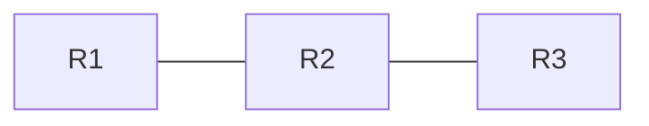

---
title: 图表编号与交叉引用示例
tags: [内容增强]
---

# 图表编号与交叉引用示例

正文里的图与表会自动编号（图 1、图 2、表 1…），无需手写序号。编号跟随界面语言，切到 English 会变成 Figure 1 / Table 1。

## 自动编号

先看一张 Mermaid 图：

再看一张表：

| 设备 | 型号 | 角色 |
|------|------|------|
| SW1 | S5735 | 接入 |
| SW2 | S6730 | 核心 |
| R1 | AR6121 | 出口 |

独立成段的图片也会编号：

## 别名与交叉引用

给图/表起别名：在它**紧邻上一行**写一个 HTML 注释 `<!-- #fig:别名 自定义标题 -->`（表用 `#tbl:`）。

<!-- #fig:topology 网络拓扑示意 -->

<!-- #tbl:qos 队列与业务对照 -->
| 队列 | 业务 | 优先级 |
|------|------|--------|
| EF | 语音 | 最高 |
| AF41 | 视频会议 | 高 |
| BE | 普通上网 | 默认 |

引用它们：用**标准 Markdown 链接**指向自动生成的锚点，链接文字留空即可自动填成「图 N」：

- 拓扑见 
- 队列对照见 
- 也可以用数字锚点直接引用第一张图：

点击引用会滚动到目标并短暂高亮，不会跳转离开当前文档。

## 复制锚点链接

鼠标悬停题注右侧会出现链接图标，点击复制直达地址（形如 `#/docs/examples/figure-examples.md#fig:topology`），可直接粘到聊天或工单里。

## 排除编号

不想被编号时，给元素外层加 `class="no-figure"`。画廊、徽章行等本来就不会被编号（只编号「独立成段且无其它文字」的图片）。

## 说明

- 编号对象：Mermaid / PlantUML / ApexCharts 图表、独立成段的图片、正文表格
- 公式不参与编号，避免技术文档编号过密
- 图题在下、表题在上，符合排版惯例
- 打印时图表与题注不会被分页截断
